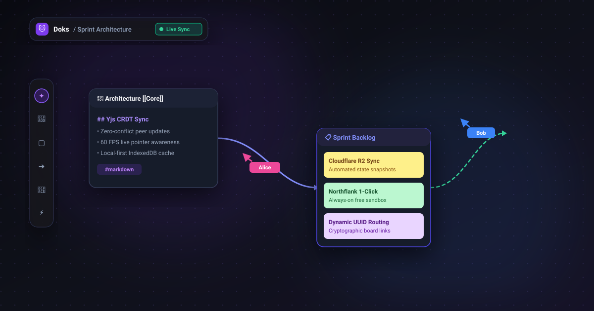

<div align="center">

  <a href="https://github.com/Lavandos12/Doks">
    
  </a>

  <h1>Doks</h1>
  <p><b>Совместное рабочее пространство и бесконечный холст</b></p>
  <p><i>Современная opensource-альтернатива Miro и Obsidian с архитектурой Local-First, мгновенной синхронизацией Yjs CRDT и развертыванием в облаке 24/7.</i></p>

  <p align="center">
    <a href="https://github.com/Lavandos12/Doks/actions/workflows/ci.yml">
      
    </a>
    <a href="https://opensource.org/licenses/Apache-2.0">
      
    </a>
    <a href="https://nodejs.org/">
      
    </a>
    <a href="https://hub.docker.com/">
      
    </a>
  </p>

  <p align="center">
    <a href="README.md">🌐 <b>English Version</b></a> •
    <a href="#-развертывание-в-облаке">🚀 <b>Деплой в 1 клик</b></a> •
    <a href="#-быстрый-старт">⚡ <b>Быстрый старт</b></a> •
    <a href="#1-матрица-возможностей">✨ <b>Матрица возможностей</b></a> •
    <a href="#2-бенчмарки">📊 <b>Бенчмарки</b></a>
  </p>

  <p align="center">
    
  </p>

</div>

---

## ✨ Ключевые возможности

<table>
  <tr>
    <td width="50%">
      <h3>🎨 Бесконечный холст Miro-уровня</h3>
      <ul>
        <li><b>60 FPS Pan & Zoom</b>: Плавное перемещение и масштабирование с точечной координатной сеткой.</li>
        <li><b>Умные коннекторы</b>: Магнитные стрелки Безье, ортогональные и прямые линии, следующие за блоками.</li>
        <li><b>Богатый набор виджетов</b>: Цветные стикеры, чек-листы, Канбан-доски и таблицы.</li>
      </ul>
    </td>
    <td width="50%">
      <h3>📝 Obsidian-совместимое хранилище</h3>
      <ul>
        <li><b>Стандартный Markdown</b>: Двунаправленные <code>[[Вики-ссылки]]</code> и обратные ссылки.</li>
        <li><b>Разделенный экран</b>: Одновременная работа с Markdown-заметками и бесконечным холстом.</li>
        <li><b>Универсальный импорт</b>: Поддержка форматов <code>.canvas</code>, <code>.md</code>, Word <code>.docx</code> и <code>.csv</code>.</li>
      </ul>
    </td>
  </tr>
  <tr>
    <td width="50%">
      <h3>⚡ Совместная работа в реальном времени (CRDT)</h3>
      <ul>
        <li><b>Без конфликтов</b>: Разрешение правок на бесконфликтных типах данных (Yjs CRDT).</li>
        <li><b>Живое присутствие</b>: Неоновые курсоры соавторов, выделения и индикаторы статуса.</li>
        <li><b>Динамические ссылки</b>: Приватные комнаты по защищенным UUID-ссылкам <code>/b/:boardId</code>.</li>
      </ul>
    </td>
    <td width="50%">
      <h3>☁️ Гибкое развертывание 24/7</h3>
      <ul>
        <li><b>Northflank</b>: Бесплатный Sandbox с постоянным диском и без засыпания.</li>
        <li><b>Render + Cloudflare R2</b>: Бесплатный контейнер + 10 ГБ бесплатного S3-хранилища снимков.</li>
        <li><b>Docker Compose</b>: Автономный запуск на любом VPS одной командой.</li>
      </ul>
    </td>
  </tr>
</table>

---

## 🚀 Развертывание в облаке

### Вариант 1: Northflank (Рекомендуется — 24/7 без засыпания с постоянным диском)

Бесплатный developer Sandbox тариф Northflank предоставляет круглосуточную работу и **1 ГБ постоянного тома** без засыпания и без привязки банковской карты:

1. Сделайте Fork или импортируйте репозиторий на GitHub.
2. Войдите на [Northflank](https://northflank.com/) и создайте **Combined Service**.
3. Выберите репозиторий `Lavandos12/Doks`, укажите порт `4780` и примонтируйте **1 GB Persistent Volume** к директории `/app/data`.
4. Нажмите **Deploy** — инстанс активен 24/7 с сохранением всех данных!

### Вариант 2: Render + Cloudflare R2 (Бесплатный хостинг + S3-снимки)

Запуск на бесплатном тарифе Render в связке с Cloudflare R2 для персистентности данных между перезапусками:

[](https://render.com/deploy)

Для активации постоянных снимков в R2:
1. Создайте бесплатный бакет в [Cloudflare R2](https://www.cloudflare.com/products/r2/) (10 ГБ бесплатно навсегда, 0$ за трафик).
2. Задайте переменные окружения в настройках сервиса Render:
   - `R2_ENDPOINT`: `https://<ACCOUNT_ID>.r2.cloudflarestorage.com`
   - `R2_BUCKET`: `doks-vault`
   - `R2_ACCESS_KEY_ID`: `<ваш_access_key>`
   - `R2_SECRET_ACCESS_KEY`: `<ваш_secret_key>`
3. Doks автоматически восстанавливает хранилище из R2 при старте и делает регулярные снимки.
4. **Устойчивость Local-First:** Помимо облака, доски сохраняются в браузере через IndexedDB (`doks_local_vault`).

---

## ⚡ Быстрый старт

### Вариант 1: Docker Compose (Универсально и рекомендуется)

```bash
git clone https://github.com/Lavandos12/Doks.git
cd Doks
docker compose up -d
```

Откройте `http://localhost:4780` в браузере. Все заметки, холсты и медиафайлы сохраняются в томе `doks_data`.

### Вариант 2: Автономный рабочий сервер

```bash
# Сборка автономного защищенного бандла
npm run pack:release

# Запуск сервера
npm start
```

### Вариант 3: Локальная разработка

```bash
# Установка зависимостей
npm install

# Запуск в режиме разработки
npm run dev
```

---

## 1. Матрица возможностей

| Возможность | Статус | Описание |
|---|---|---|
| **Архитектура Local-First** | Поддерживается | 100% автономность с сохранением в IndexedDB (`doks_local_vault`) и на диск в файлы `.md` и `.canvas` |
| **Универсальные ссылки** | Поддерживается | Мгновенный шеринг досок `/b/:boardId`; гости подключаются без регистрации |
| **Совместный холст в реальном времени** | Поддерживается | Стикеры, фреймы, карточки заметок, стрелки, формы, 60 FPS курсоры через Yjs CRDT |
| **Заметки уровня Obsidian** | Поддерживается | CodeMirror 6, Live Preview, коллауты (`[!note]`), свойства frontmatter, аутлайн, `[[вики-ссылки]]` |
| **Phone Bridge** | Поддерживается | Векторный QR-код для мгновенного просмотра с мобильного телефона по Wi-Fi или Cloudflare Tunnel |
| **Полнотекстовый поиск** | Поддерживается | Движок MiniSearch для мгновенного поиска по заголовкам, тексту и тегам (`Ctrl+Shift+F`) |
| **Экспорт контекста для ИИ (`doks-ai/1`)** | Поддерживается | Детерминированная сборка контекста для Claude, Gemini и ChatGPT за < 20 мс |
| **Снимки и Корзина** | Поддерживается | Мягкое удаление с хранением 30 дней, снимки состояния, потоковый экспорт в `.zip` без утечек памяти |
| **Контейнеризация и облако** | Поддерживается | Многоэтапный Docker-образ (< 120 МБ), динамический `$PORT`, деплой на Render и Northflank |

---

## 2. Бенчмарки

Автоматизированные сквозные и интеграционные бенчмарки на базе тестовых наборов Vitest и Playwright:

- **Отрисовка 1 000 объектов:** 398 мс начальный рендер, отзывчивое панорамирование (~28 FPS при 1 000 параллельных узлов холста).
- **Задержка CRDT-синхронизации:** Менее 50 мс на локальной сети / loopback между независимыми клиентами.
- **Сборка ИИ-контекста (`doks-ai/1`):** Полная выгрузка доски с 1 000 узлами, фреймами и заметками выполняется быстрее 20 мс.
- **Потоковый экспорт хранилища в ZIP:** 0 МБ всплесков памяти (потоковый конвейер Store-mode без буферизации в RAM).
- **Сквозной E2E-набор:** Все сценарии совместной работы браузеров проходят за ~8.8 секунд.

---

## 3. Ограничения

- **Скрипты запуска (`doks.bat` / `doks.sh`):** В предыдущих версиях применялись командные файлы `doks.bat` и `doks.sh`. Doks перешел на современные облачные стандарты через Docker и `npm start`.
- **Обнаружение пиров:** Автопоиск работает в локальной подсети через UDP-маяк на порту `41234`. Межсетевое взаимодействие осуществляется по защищенным ссылкам `/b/:boardId` или через Phone Bridge.
- **Персистентность в эфемерных средах:** На бесплатных тарифах без постоянного тома перезапуск сбрасывает данные контейнера. Однако Doks автоматически восстанавливает состояние холста из локального хранилища IndexedDB (`doks_local_vault`) браузеров соавторов.

---

## 4. Конфигурация и переменные окружения

| Переменная | По умолчанию | Описание |
|---|---|---|
| `PORT` | `4780` | Порт сервера HTTP и WebSocket (автоматически переопределяется облачными платформами) |
| `DOKS_HOST` | `0.0.0.0` | Сетевой адрес привязки (`0.0.0.0` для Docker/облака, `127.0.0.1` только для loopback) |
| `DOKS_DATA_DIR` | `./data` | Путь к директории хранения заметок Markdown, холстов и вложений |
| `WORKSPACE_PASSWORD` | *(нет)* | Опциональный пароль для ограничения записи на доски |

---

## 5. Горячие клавиши

| Сочетание | Действие |
|---|---|
| `Ctrl+P` | Командная строка |
| `Ctrl+O` | Быстрое переключение заметок / досок |
| `Ctrl+Shift+F` | Глобальный полнотекстовый поиск |
| `Ctrl+E` | Переключение Live Preview / Markdown редактор |
| `Ctrl+Shift+E` | Экспорт контекста для ИИ (`doks-ai/1`) |
| `S` / `N` / `T` / `F` / `C` / `R` / `I` | Инструменты холста: Стикер, Заметка, Текст, Фрейм, Стрелка, Форма, Вложение |
| `Tab` *(внутри стикера)* | Создать связанный стикер справа |
| `Ctrl+Enter` *(внутри стикера)* | Создать связанный стикер снизу |
| `Delete` / `Backspace` | Мягкое удаление выбранного объекта в Корзину |
| `Ctrl+Z` / `Ctrl+Y` | Отмена / Повтор действия |

---

## 6. Архитектура и документация

- [Обзор архитектуры](docs/architecture.md)
- [Форматы и стандарты данных](docs/formats.md)
- [Модель угроз и безопасность](docs/threat-model.md)
- [Часто задаваемые вопросы (FAQ)](docs/faq.md)

---

## 7. Лицензия

Распространяется под свободной лицензией **Apache License 2.0**. См. [LICENSE](LICENSE) для подробностей.
